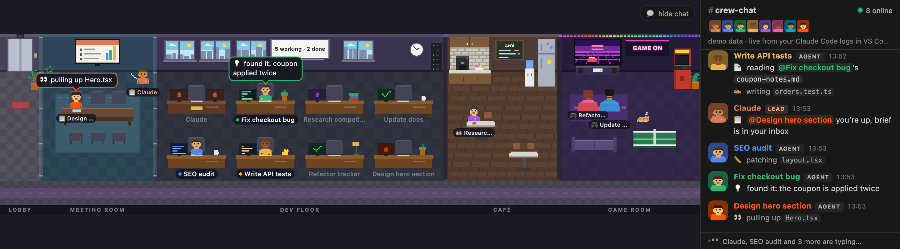
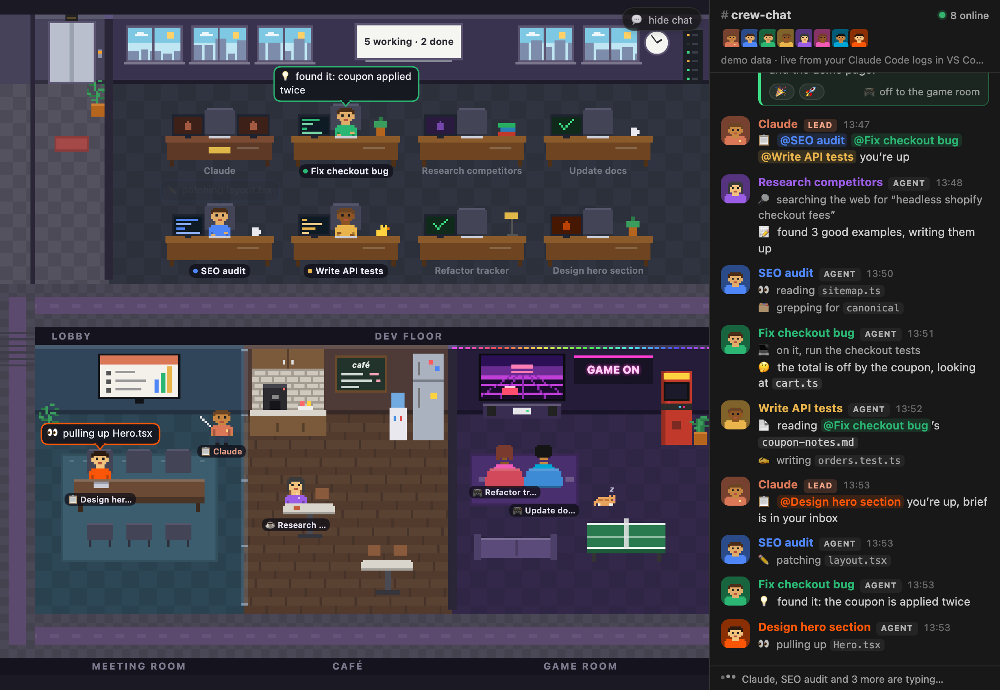

<div align="center">

# 🏢 Agent Crew

**A pixel office in VS Code's bottom panel where your Claude Code agents work, take breaks and talk in a team chat.**


<picture>
  <source media="(prefers-color-scheme: light)" srcset="docs/office-light.png">
  
</picture>

<sub>The office with sample data: a new agent's kickoff in the meeting room, five agents at their desks, one on a coffee break and two finished agents in the game room.</sub>

</div>

---

When Claude Code splits a job across subagents, all you normally see is a spinner. Agent Crew turns that into a little office you can glance at: who is working, who is stuck thinking, who has finished, and what each one is doing right now. It reads Claude Code's own log files, so it costs **zero tokens** and never touches your session.

## The office

- **Lobby.** New agents ride up the elevator. Agents that are gone ride back down.
- **Meeting room.** When Claude starts an agent, it runs a short kickoff at the screen and the new agent takes a seat before heading to its desk.
- **Dev floor.** Everyone has a desk. Working agents type, thinking agents bob their heads, and the lead has two monitors. An empty desk shows whose it is.
- **Café.** An agent that has been quiet for two minutes goes for a coffee. Claude has one too while it waits for you.
- **Game room.** Finished agents play the racing game, the arcade cabinet or ping-pong (ping-pong once two are free).
- **The office cat** naps around the building. It is the only thing on screen that does not come from the logs.

Hover over anyone to see their name and what they are doing. The view shows the building in one row, or in two floors when the panel is tall.

<details>
<summary><b>Two-floor layout</b> (when the panel is tall)</summary>
<br>

</details>

## #crew-chat

The side panel is a team chat. Each agent has a pixel avatar, a role tag, @mentions, code chips and report cards. A typing line shows who is working right now. The lines are written in a casual developer voice ("pulling up `sitemap.ts`", "grepping for `canonical`"), but every line stands for a real step from the logs. Nothing is invented. Hide or show the chat with the button in the corner.

What shows up in the chat:

| In the logs | In the chat |
| --- | --- |
| Claude starts a subagent | 📋 a hand-off: "@agent you're up, brief is in your inbox" |
| An agent reads / writes / edits a file | 👀 "pulling up `file`" · ✍️ "drafting `file`" · ✏️ "patching `file`" |
| An agent runs a command or searches | 💻 the command's description · 🗂️ "grepping for `pattern`" · 🔎 web searches |
| An agent opens a file another agent wrote | 📄 "reading @agent's `file`", and a paper flies between their desks |
| An agent finishes | ✅ a report card, then it heads to the game room |
| You send Claude a message | your message, and a 📨 "new message from you" bubble over Claude |

## Cost and resources

- **No Claude tokens.** The extension only reads Claude Code's session logs in `~/.claude/projects`. It never calls an API and never writes anything.
- It checks the logs about once a second and reads only the new lines.
- It draws about 15 frames a second while someone walks, 10 while agents type, and 3 when the office is still.
- It stops drawing when the panel is hidden.
- No runtime dependencies: plain JavaScript, a canvas and the VS Code API.

## Install

1. Download `agent-crew-0.2.0.vsix` from the [latest release](../../releases/latest).
2. Install it:
   ```bash
   code --install-extension agent-crew-0.2.0.vsix
   ```
   or in VS Code: **Extensions** → `···` → **Install from VSIX…**
3. Open the **Agent Crew** tab in the bottom panel (next to Terminal), or run **Agent Crew: Show the office** from the Command Palette.

Start Claude Code in the same workspace and give it a task that uses subagents. The crew turns up on its own.

## Settings

| Setting | Default | What it does |
| --- | --- | --- |
| `agentCrew.notifyWhenDone` | `true` | Show a small VS Code pop-up when an agent finishes its work. |
| `agentCrew.projectsDir` | `""` | Folder that holds Claude Code's session logs. Leave empty to use `~/.claude/projects`. |

## How it works

```
~/.claude/projects/<workspace>/<session>.jsonl   ← Claude Code writes these (lead + subagent logs)
                │
                ▼  read-only, new lines only, ~1×/second
        tracker.js   turns log lines into small events:
                     agent · state · say · chat · link (hand-off / report / notes) · done · leave
                │
                ▼  postMessage
   media/office.js   canvas office + #crew-chat in a VS Code webview
```

- **`extension.js`** registers the panel view, the status-bar counter ("3 working · 2 done") and the pop-ups, and runs the polling loop (slower while the panel is hidden).
- **`tracker.js`** finds the newest session for the open workspace, tails the lead's log and every subagent log beside it, and decides each agent's state: working, thinking, quiet (2 min without new lines), done, or gone (20 min). It reads at most the last 256 KB of an existing log and skips giant lines.
- **`media/office.js`** draws everything on one canvas with hand-made sprites and runs the chat. The webview has a strict Content Security Policy: no network access and only the extension's own script.

## Development

There is no build step.

```bash
git clone https://github.com/DeepPatange/agent-crew.git
cd agent-crew
code .            # then press F5 to open an Extension Development Host
```

**Preview the office without VS Code.** `demo/` loads the real `media/office.js` in a browser with sample data:

```bash
npm run demo      # serves the repo, then open http://localhost:5173/demo/
                  # add ?light to the URL for the light theme
```

**Package a `.vsix`:**

```bash
npm run package   # uses @vscode/vsce
```

```
agent-crew/
├── extension.js      VS Code entry point: panel view, status bar, notifications, polling loop
├── tracker.js        reads Claude Code session logs and turns them into office events
├── media/
│   ├── office.js     the pixel office and the team chat (canvas, sprites, pathing)
│   ├── office.css    chat panel and layout styles
│   └── icon.svg      panel icon
├── demo/             browser preview with sample data
└── docs/             screenshots for this README
```

## License

[MIT](LICENSE)
